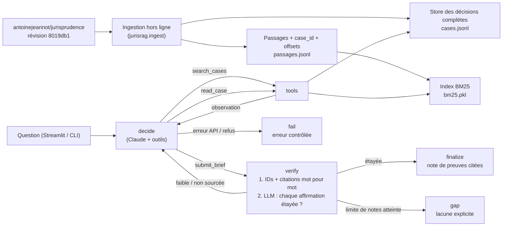

# Architecture

## Vue d'ensemble

L'index trouve des **pistes** ; le store fournit le **texte original** servant aux citations.
Chaque citation finale est retrouvée mot pour mot dans la décision et localisée par ses offsets.

## Graphe LangGraph (`src/jurisrag/agent.py`)

| Nœud | Rôle | Sorties conditionnelles |
|---|---|---|
| `decide` | Un appel Claude avec les outils `search_cases`, `read_case`, `submit_brief`. Chaque appel porte un champ `rationale` (une phrase) affiché comme DECISION. | `tools`, `verify`, `decide` (relance si pas d'outil), `fail` |
| `tools` | Exécute les appels, ajoute les passages vus au pool de preuves, renvoie les `tool_result` (ou `is_error`). | → `decide` |
| `verify` | Contrôle mécanique puis contrôle de support par LLM. En cas d'échec, les défauts exacts reviennent à l'agent comme résultat de `submit_brief`. | `finalize`, `decide`, `gap`, `fail` |
| `finalize` / `gap` / `fail` | Construisent la sortie finale et l'événement FINAL. | → END |

**État partagé** : question, messages, preuves vues (`passage_id → passage`), décisions lues,
appels en attente, brouillon, résultat de vérification, compteurs (outils, notes, tours LLM), statut, trace.

**Conditions d'arrêt explicites**

| Condition | Limite | Effet |
|---|---|---|
| Note vérifiée | — | `finalize` (statut `verified` ou `insufficient_evidence`) |
| Appels d'outils | 5 | seul `submit_brief` reste proposé ; consigne de déclarer les lacunes |
| Notes rejetées | 3 | `gap` : on ne garde que les affirmations vérifiées, le reste devient lacune |
| Tours de décision | 12 | `fail` |
| Erreur API, refus, `max_tokens` | — | `fail` (erreur contrôlée, visible dans la trace) |

## Vérification (`src/jurisrag/verifier.py`, `src/jurisrag/brief.py`)

1. **Mécanique (déterministe)** : `passage_id` existant **et** effectivement reçu pendant le run ;
   citation ≥ 6 mots retrouvée mot pour mot (seuls espaces et apostrophes typographiques tolérés) ;
   chaque affirmation a au moins une citation ; une réponse `answered/partial` sans affirmation est rejetée.
2. **Support (LLM, sortie JSON contrainte)** : par affirmation `supported / partially_supported /
   unsupported` ; le constat principal découle-t-il des affirmations ; liste des éléments non sourcés.
   Une prétention de partie (zone `moyens`) présentée comme position de la Cour est `unsupported`.

La note n'est acceptée que si les deux niveaux passent sans défaut.

## Baseline statique (`src/jurisrag/baseline.py`)

Même index, même format de note : une recherche avec la question brute (k = 5), un appel LLM.
Le contrôle mécanique est calculé pour la comparaison mais n'est jamais renvoyé au modèle.
